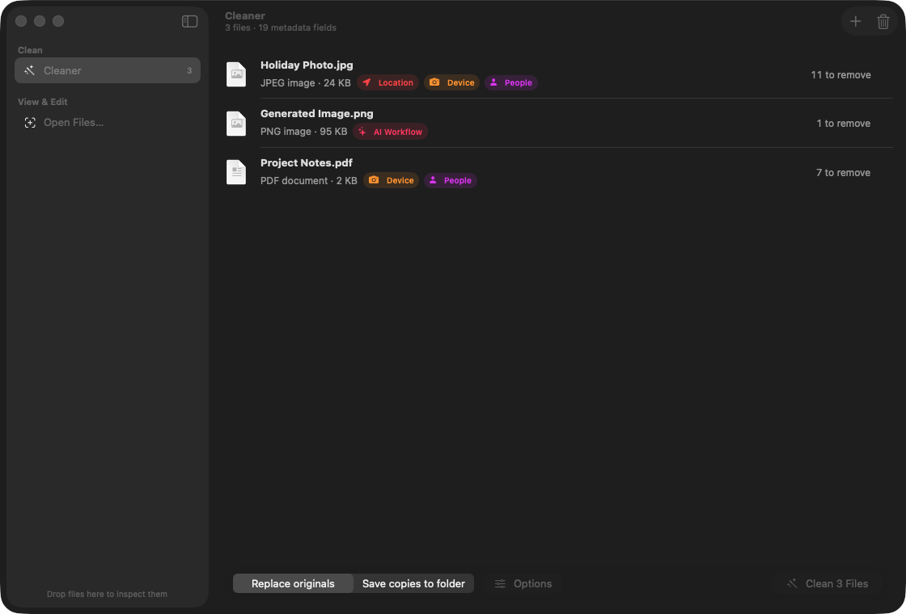
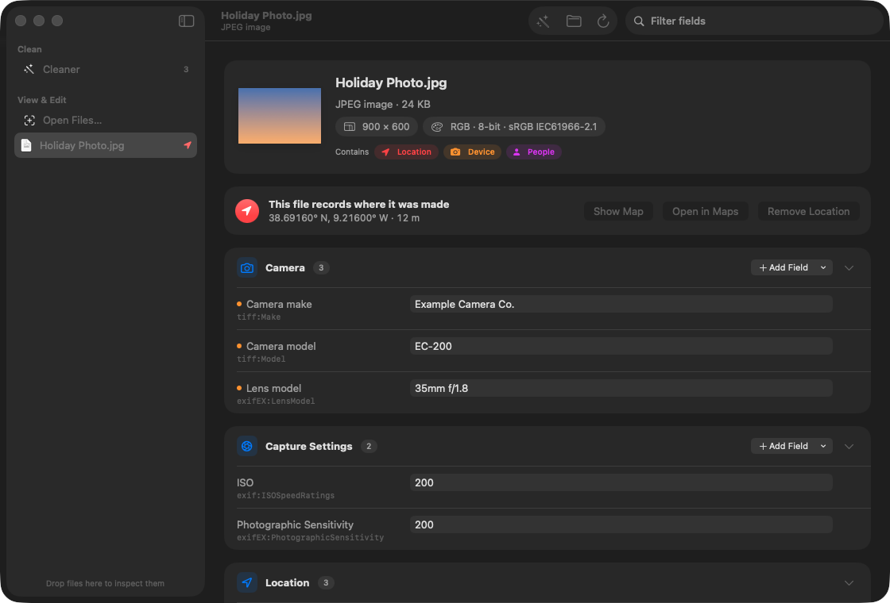
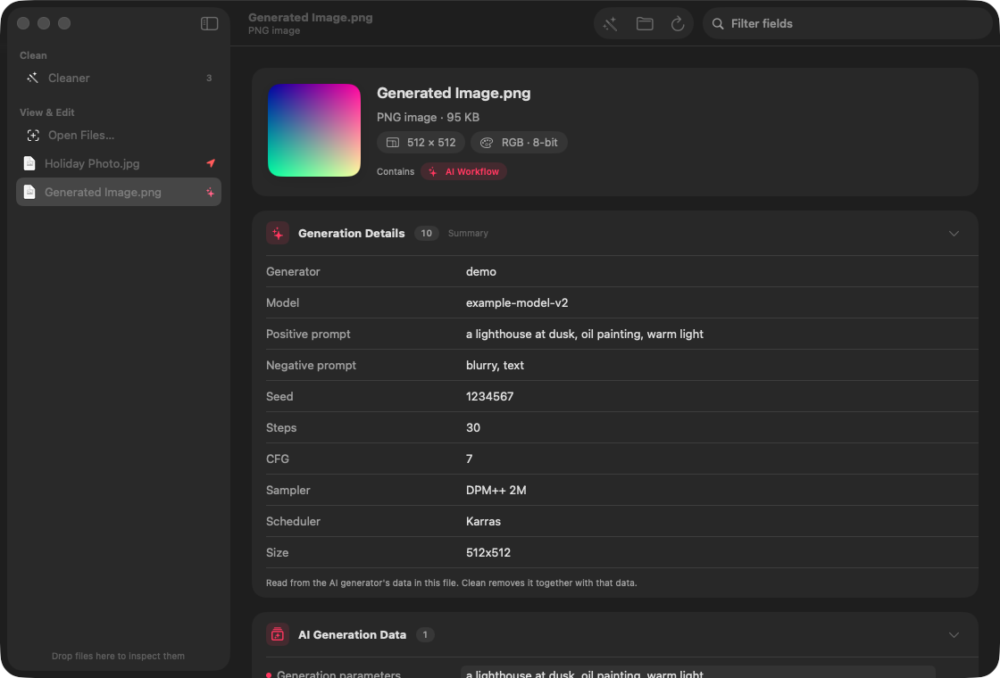

# MetaScrub

A macOS app (SwiftUI, Liquid Glass) for seeing, editing and removing the metadata inside files:
GPS positions in photos, camera and phone models, authors and companies in documents, edit
history, encoder tags, the prompts and workflows AI image generators save, and the "downloaded
from" records macOS attaches to files.

It has two parts, picked in the sidebar:

- **Cleaner**: drop any number of files or folders, press **Clean**. Choose **Replace originals**
  (asks once; "Don't ask again" skips that) or **Save copies to folder**. Each row shows what
  kind of personal data was found (Location, Device, People, History) and, afterwards, how many
  fields were removed and anything kept (hover for details).
- **Viewer**: drop files (on the window, the sidebar or the Dock icon) to see every field,
  grouped into sections. Click a value to edit it, hover a row to remove it, use **Add Field**
  for new ones. Changes are listed in a bar at the bottom: **Save** rewrites the file, **Save
  As…** writes a copy and leaves the original alone, **Revert** drops the edits. Photos and
  videos with a position get a location card; the map only loads when you press **Show Map**
  (it fetches tiles from Apple Maps). **Send to Cleaner** moves a file to the Cleaner.
  Right-click a row for **Copy Value**; long values (such as a whole workflow) also have a Copy
  button.

### AI image generators

Images from ComfyUI, Automatic1111/Forge, Draw Things, InvokeAI, SwarmUI, NovelAI and Fooocus
carry the generator's data: ComfyUI saves its node graph (`prompt`) and canvas (`workflow`) as PNG
text, Automatic1111-style tools a `parameters` text (in PNG text, or the EXIF user comment in JPEG
and WebP), and Draw Things a parameters line in the PNG Description plus a JSON object in the EXIF
user comment. Generator data is recognised by name and by content, wherever it is stored. The viewer shows it under **AI Generation Data** and tags the file "AI Workflow"; a
**Generation Details** summary lists the model, LoRAs, prompts, seed, steps, CFG, sampler,
scheduler and size. JSON (node graphs, workflows) and fields over 4,000 characters are read-only
(Copy takes them); plain parameter text can be edited, and any of them removed. Saving other edits
keeps them. Clean removes all of it.

Cleaning options (Cleaner → Options): remove extended attributes (on), keep the colour profile
(on), keep the orientation (on), keep the original file dates (off; otherwise the cleaned file is
dated now).



 

*Screenshots show generated files with made-up metadata.*

MetaScrub is open source under the GNU General Public License, version 3 or later (`LICENSE`). Copyright (C) 2026 omso.

## Download

Download the newest preview from the [Releases page](https://github.com/kitedrake/metascrub/releases): the
`MetaScrub-<version>.zip` file under **Assets**. It needs macOS 26 or later on a Mac with Apple silicon.

**Preview build.** MetaScrub isn't signed or notarized by Apple yet, so macOS warns about it the first time you open
it. To open it anyway:

1. Unzip the download and move MetaScrub to your Applications folder.
2. Open MetaScrub. When macOS says it can't verify the app, click **Done**.
3. Open **System Settings › Privacy & Security**, scroll down to **Security** and click **Open Anyway** next to the
   message about MetaScrub. The button shows for about an hour after you tried to open the app.
4. Confirm with **Open Anyway** and your password or Touch ID when macOS asks. From then on, MetaScrub opens normally.

On current macOS, right-clicking the app and choosing **Open** no longer skips this warning. If you prefer Terminal:
`xattr -dr com.apple.quarantine /Applications/MetaScrub.app`

## What it handles

| Format | Read | Edit | Clean | How cleaning works |
| --- | --- | --- | --- | --- |
| JPEG | EXIF, GPS, IPTC, XMP, maker notes, AI parameters in EXIF | yes | yes | Drops EXIF/XMP/IPTC/comment/preview segments and anything after the image; keeps the compressed picture byte for byte, JFIF density, Adobe colour info, ICC profile (option) and a minimal orientation tag (option) |
| PNG | text chunks (incl. AI workflows), EXIF, XMP | yes: text chunks directly, other fields by a lossless rewrite that keeps every text chunk | yes | Keeps only image, transparency, colour, animation (APNG) and density chunks |
| HEIC / HEIF / AVIF | EXIF, GPS, XMP | yes (lossless copy; re-compresses only if macOS refuses a change, and says so) | yes | Blanks the EXIF and XMP items in place; the picture, depth and HDR data, orientation and colour are untouched |
| GIF | comments, XMP | read-only | yes | Keeps frames, timing and looping; drops comments and other application blocks |
| WebP | EXIF, XMP | read-only (macOS can't write WebP) | yes | Drops the EXIF and XMP chunks and their header flags |
| TIFF | EXIF, GPS, IPTC, XMP | yes | yes | Re-saves the pixels without metadata (lossless) |
| Other images ImageIO reads (camera raw, PSD, BMP…) | yes | no | file attributes only | — |
| MP3 | ID3v2.2–2.4, ID3v1, APE | ID3v2.3/2.4 and ID3v1 | yes | Keeps only the audio frames |
| FLAC | Vorbis comments, pictures, other blocks | comments, remove pictures/blocks | yes | Keeps stream info and seek table |
| WAV | INFO, bext, iXML, XMP, ID3 | INFO fields | yes | Keeps format, audio, cue/loop/instrument chunks |
| AIFF / AIFF-C | name/author/copyright/annotation, comments, ID3 | text chunks | yes | Keeps format, audio, markers, instrument, channel layout |
| MP4 / MOV / M4A / M4V / 3GP | iTunes tags, QuickTime metadata and user data, location | yes (pass-through export, nothing re-encoded) | yes | Turns the metadata boxes into padding of the same size and zeroes the recording times; nothing moves |
| PDF | Info dictionary, XMP, comment authors | Info fields, remove XMP | yes | PDFKit re-saves it (dropping old revisions); then the XMP packet, Producer and dates are blanked and comment author names cleared |
| Word / Excel / PowerPoint (docx, xlsx, pptx…) | core, app and custom properties, thumbnail, part dates | yes | yes | Empties core and custom properties, removes company/manager/template/editing time and the thumbnail, resets the ZIP part dates |
| OpenDocument (odt, ods, odp…) | meta.xml, thumbnail | yes | yes | Empties meta.xml (keeps statistics), removes the thumbnail |
| Any other file | file info, extended attributes, Spotlight | dates, remove attributes | extended attributes | — |

For every file the viewer also shows file-system details (dates are editable), extended
attributes (download source, quarantine, Finder tags; each removable), and what Spotlight indexed.

After cleaning, the file is read again and anything still present is reported as "kept" rather
than assumed gone.

### Known limits

- Saving edits to MP4-family files goes through AVFoundation's pass-through export. Codecs it
  can't copy (for example xHE-AAC audio) fail with a message and the file is left as it was;
  cleaning those files still works.
- PDFKit doesn't keep custom Info fields when saving, and stamps its own Producer; MetaScrub puts
  the Producer back when it fits in the same space. Names inside Office documents (comment and
  tracked-change authors) and inside PDF page content aren't changed.
- ID3v2.2 tags, timed metadata tracks in videos, Ogg/Opus, Matroska/WebM, EPUB and camera raw
  files are read-only or not read.
- macOS adds a few attributes it protects itself (`com.apple.provenance`, `com.apple.macl`); they
  can't be removed and aren't counted.

## Build and run

```sh
./build.sh                       # builds build/MetaScrub.app (ad-hoc signed, local use)
open build/MetaScrub.app
```

Requires macOS 26 (Liquid Glass) and Xcode 26 or newer; the script uses Xcode's toolchain. Copy
the app to /Applications to keep it. The icon is drawn by `icon/make_icon.swift`; run
`icon/make-icns.sh` to rebuild `Resources/AppIcon.icns`.

### With omso Builder

The repository is registered in omso Builder and describes its build in `omso-build.json`:
`build.sh`, the engine tests (`test.sh`), then `MetaScrub --self-test`, which makes a photo and a
PDF with personal metadata in the run folder and checks that cleaning and editing work and leave
the pixels and text alone. **Build & Install** then copies `MetaScrub.app` into
`/Applications/omso` (the only app folder omso Builder installs to).

Command line (same engine, no window):

```sh
build/MetaScrub.app/Contents/MacOS/MetaScrub --inspect FILE…
build/MetaScrub.app/Contents/MacOS/MetaScrub --clean FILE… --out FOLDER
build/MetaScrub.app/Contents/MacOS/MetaScrub --clean FILE… --in-place
build/MetaScrub.app/Contents/MacOS/MetaScrub --self-test FOLDER   # checks the build on generated files
```

Clean options: `--keep-attributes`, `--drop-color-profile`, `--drop-orientation`, `--keep-dates`.

## Updates and releases

Released copies update themselves with [Sparkle](https://sparkle-project.org) 2.10.1 (pinned in
`Package.swift`). A plain `./build.sh`, and omso Builder's builds, have no update feed: they never
check for updates and show no update menu items.

A release build gets its feed and key from the environment; the release tool in the
`software-site` repository sets them:

| Variable | What it does |
| --- | --- |
| `UPDATE_FEED_URL` | the update feed, `<site>/updates/metascrub/appcast.xml` |
| `UPDATE_PUBLIC_KEY` | the EdDSA public key; an update signed with any other key is refused |
| `SIGN_IDENTITY` | codesign identity: a Developer ID for releases (default: ad-hoc) |

Such a build has **Check for Updates…** and **Check for Updates Automatically** in the app menu.
Sparkle asks on the second launch whether to check automatically, and sends nothing before that. A
check downloads the feed from the site; the request names the app and its version, and system
profiling stays off, so nothing about the Mac or its files is sent (the server sees the IP address,
as with any web request).

To release: bump `VERSION` and push it, then push an annotated tag whose message is the release
notes, one note per line:

```sh
git tag -a v1.2.3 -m "First note" -m "Second note" && git push origin v1.2.3
```

The Release workflow (`.github/workflows/release.yml`) runs `scripts/release-ci.sh` on a GitHub Mac:
it builds with the update feed, runs the tests and the self-test, signs and notarizes the app when
the Apple secrets are set, signs the update when `SPARKLE_PRIVATE_KEY` is set, and publishes a
GitHub release with the zip and `update.json` (a pre-release until it's notarized). kitedrake.com
then lists it for download and, once it's signed and notarized, in the update feed. A push to `main`
that changes the workflow or the script does a dry run without publishing. `scripts/release-ci.sh`
is the same file in every Kitedrake app repository: change all copies together. `sh
scripts/test-update.sh metascrub` in the site repository tests a real update end to end with a
throwaway key, including refusing an update signed with another key. Sparkle's XPC services are left
out of the app because MetaScrub isn't sandboxed.

## Tests

```sh
./test.sh                        # xcrun swift test with Xcode's toolchain; extra arguments are passed on
```

The tests build sample files for every format (with known metadata), then read, edit and clean
them and check the content survives. An opt-in smoke test runs the same edit-then-clean cycle on
copies of real files and checks pixels, decoded audio, video frames and PDF text are unchanged:

```sh
METASCRUB_SAMPLES=/path/to/folder ./test.sh --filter RealFileTests
```

## Layout

```text
Sources/MetaScrubCore/      engine, no UI
  Model.swift               report, sections, entries, edits, options
  Engine.swift              inspect / clean / save, file replacement
  FileFormat.swift          format detection from the first bytes
  FileSystem.swift          file info, extended attributes, Spotlight, safe writing
  Binary.swift              byte reading/writing helpers, CRC-32
  Formats/                  one handler per family (images, ID3/MP3, FLAC, WAV/AIFF, MP4, PDF, ZIP/Office)
Sources/MetaScrub/          SwiftUI app: sidebar, Cleaner, Viewer, command line, snapshots, updates
Tests/MetaScrubCoreTests/   fixtures and per-format tests
```
